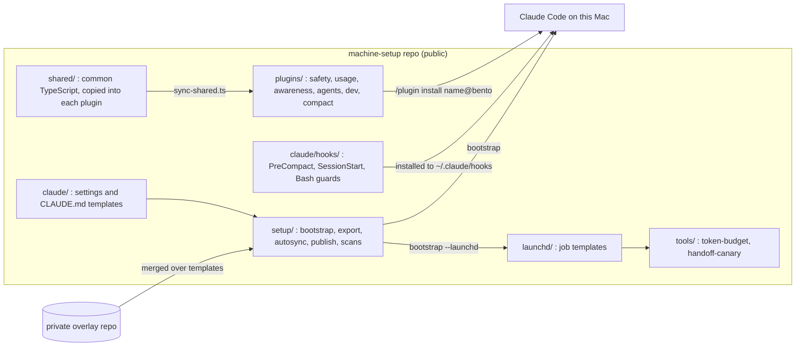
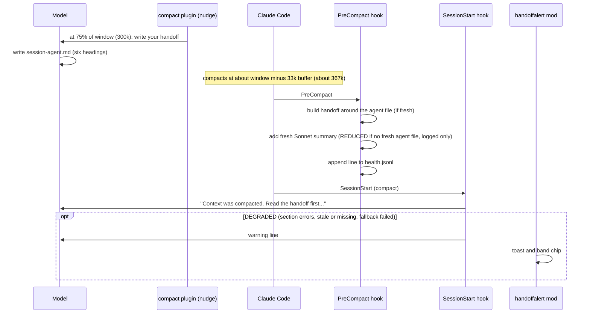
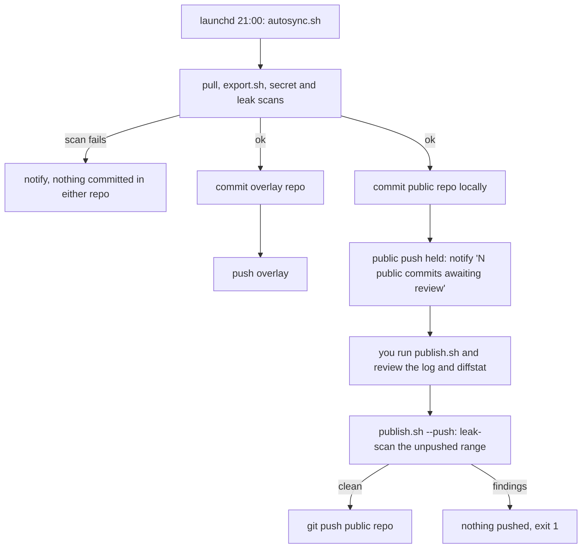

# Architecture

Bento is three things that share one repo: a marketplace of six Claude Code plugins, a few command-line tools that run on a schedule (token budget, handoff canary), and macOS scripts that install all of it on a machine. This page describes how the parts fit together. Behaviour is specified in [`specs/`](specs/); decisions are recorded in [`docs/adr/`](docs/adr/README.md).

## Components

### Plugins (marketplace `bento`)

Six plugins, 26 mods. Every mod can be switched off with a `mod_<name>_enabled` option, and none calls a model API unless its spec says so ([ADR 0005](docs/adr/0005-mods-add-zero-model-context.md)). A plugin cannot import another plugin; cross-plugin reads go through published state atoms ([`specs/00-conventions.md`](specs/00-conventions.md)).

| Plugin | Version | Mod | What it does |
|---|---|---|---|
| `safety` | 1.0.3 | `protect` | Refuses writes to `.env*`, lockfiles and other protected paths. |
| | | `checkpoint` | Snapshots the working tree to a private git ref after each turn that changed files. |
| `usage` | 1.0.5 | `burn` | Burn Meter: 5-hour and weekly limits with pace. |
| | | `cache` | Cache Clock: prompt-cache countdown and cold-return cost. |
| | | `compaction` | Compaction Alert: context fill and compaction count. |
| `awareness` | 1.0.4 | `headsup` | Rate-limited toasts (cache, long command, context, pace, big output). |
| | | `nowdoing` | Phase band: research, plan, build, verify, report. |
| | | `spec` | Spec Tracker: checkbox progress of a plan or spec file. |
| | | `focus` | Focus Timer that silences Heads-Up toasts. |
| `agents` | 1.2.0 | `pets` | Pane of running subagents with model, task and clock. |
| | | `review` | Review Queue for finished subagent work. |
| | | `delegation` | Delegation Guard: explicit model per spawn, spend by tier, nesting guard, runaway warning. |
| | | `mission` | Mission Board: plan progress across all agents, and the `step` progress tool. |
| `dev` | 1.0.4 | `git` | Branch, dirty and ahead/behind chip. |
| | | `diff` | Session Diff: files and lines changed since session start. |
| | | `pulse` | Test Pulse: pass/fail counts from recognised test runners. |
| | | `coverage` | Coverage Delta against a baseline. |
| | | `typecheck` | Runs the right type checker after edits and feeds errors back to the model. |
| | | `pr` | PR Radar: PR and check status per worktree. |
| | | `ports` | Port Watch: listeners started during the session. |
| `compact` | 1.2.0 | `coach` | Compact Coach: is now a good moment to compact, and what it saves. |
| | | `handoff` | Two-step `/handoff` that writes a handoff file before you compact. |
| | | `resume` | Points the first prompt after compaction at the saved handoff. |
| | | `nudge` | Asks the model to write its own agent handoff near the compaction threshold. |
| | | `handoffalert` | Toast and band chip when a compaction's handoff is degraded. |
| | | `orch` | Orchestrator mode: a short system-prompt section about delegation. |

Versions come from each `plugins/<name>/.claude-plugin/plugin.json` and `.claude-plugin/marketplace.json`. Each plugin's `hooks/register.tsx` is the only place that calls the host API; mods under `hooks/mods/` are wired from there. Code used by more than one plugin lives in [`shared/`](shared/) and is copied into `plugins/*/hooks/_shared/` by `scripts/sync-shared.ts` (edit `shared/`, never the copies).

### Machine hooks

Plain command hooks installed to `~/.claude/hooks/` and registered by the settings template ([`claude/settings.template.md`](claude/settings.template.md)):

| Hook | Event | Purpose |
|---|---|---|
| `precompact-handoff.py` | `PreCompact` | Writes the deterministic handoff file and a health line. |
| `postcompact-inject.py` | `SessionStart` (matcher `compact`) | Injects the handoff into the compacted session; flags a degraded one. |
| `no-git-stash.sh` | `PreToolUse` (Bash) | Blocks `git stash` for agents. |
| `no-root-walks.py` | `PreToolUse` (Bash) | Blocks recursive walks rooted at `/` or the home folder. |
| `handoff-canary.sh` | none (launchd) | Thin wrapper around `tools/handoff-canary/run.sh`. |

### Tools

- **token-budget** ([`tools/token-budget`](tools/token-budget/README.md)): weekly probe of always-loaded token overhead (two Haiku calls), deterministic analysis against last week, spend breakdown including risky subagent sessions, and reversible proposals that only a human applies. Spec: [`docs/token-budget-spec.md`](docs/token-budget-spec.md).
- **handoff-canary** ([`tools/handoff-canary`](tools/handoff-canary/README.md)): nightly end-to-end proof that compaction plus handoff works, using two headless sessions (one with an agent handoff file, one with no agent file, relying on the fresh summary; the canary sets `HANDOFF_SUMMARY_MODEL=haiku` to stay cheap).

### Scheduled jobs

Rendered from `launchd/*.plist.tmpl` by bootstrap with `--launchd` (placeholders `__LABEL_PREFIX__`, `__HOME__`, `__REPO__`; each job gets `HOME` and a `PATH` in its environment). Dependencies are listed in `launchd/deps.tsv`.

| Job (label suffix) | Schedule | Runs |
|---|---|---|
| `machine-setup-autosync` | daily 21:00 | `setup/autosync.sh` (installed only when an overlay exists) |
| `token-budget` | Mondays 09:00, plus once at load | `tools/token-budget/run.sh --catch-up` |
| `handoff-canary` | daily 03:30, plus once at load | `tools/handoff-canary/run.sh --catch-up` |

### Setup scripts

| Script | Role |
|---|---|
| `setup/bootstrap.sh` | Installs the generic setup onto `$HOME`: directories, hooks, merged `settings.json`, `CLAUDE.md`, plugins, optional launchd jobs and repo clones. Idempotent; backs up anything it overwrites to `~/.machine-setup-backup/<timestamp>/`; `--dry-run` changes nothing. |
| `setup/export.sh` | Captures the live machine. Personal values go only to the overlay; the public repo changes only for generic files that already exist in it. Refuses without an overlay. |
| `setup/autosync.sh` | Daily pull, export and commit in both repos; pushes the overlay, holds the public push ([ADR 0012](docs/adr/0012-public-push-gate.md)). |
| `setup/publish.sh` | Shows unpushed public commits; with `--push`, leak-scans them and pushes. |
| `setup/leak-scan.sh` | Blocks personal values and secrets from the public repo (pre-commit hook, export, publish, CI). |
| `setup/secret-scan.sh` | Regex scan (plus gitleaks if installed) of the tree that would be committed, used on both repos. |

### Overlay merge

The overlay is a private repo that mirrors the public tree and is found through `MACHINE_SETUP_PRIVATE` (else a sibling directory; `none` opts out). Files at the same path replace the public ones; `claude/settings.json` is deep-merged over `claude/settings.template.json` (objects merge, permission arrays are unioned, other arrays replaced, `null` deletes a key). Details: [`OVERLAY.md`](OVERLAY.md) and [`specs/machine-setup-spec.md`](specs/machine-setup-spec.md) section 11.

## Data and state locations

Everything lives under the home directory; nothing is sent anywhere by the plugins themselves.

| Path | Written by | Contents |
|---|---|---|
| `~/.local/state/claude-handoffs/` | handoff hooks, `compact` plugin, model | `<session>-agent.md` (written by the model), `<session>-agent.meta.json` (written by the plugin), the deterministic handoff files, `<session>-degraded.json`, `health.jsonl` |
| `~/.local/state/handoff-canary/` | handoff canary | `last-run.json`, `runs/` (kept 14 days on failure), logs |
| `~/.local/state/token-budget/` (mode 700) | token-budget | `ledger.jsonl`, `manifests/`, `proposals/`, `applied.jsonl`, `backups/`, `logs/`, `last-run.json` |
| `~/.local/state/machine-setup/` | autosync | `autosync.log`, launchd output |
| `~/.machine-setup-backup/<timestamp>/` | bootstrap | copies of files it replaced |
| `~/.claude/` | bootstrap | hooks, merged `settings.json`, `CLAUDE.md` |

## Handoff lifecycle

Bento keeps the auto-compact window at 400k tokens (`CLAUDE_CODE_AUTO_COMPACT_WINDOW=400000`) instead of the 1M default. A shorter window cuts per-turn cache-read cost (it scales with context size), slows weekly-limit consumption and avoids the quality loss of very long contexts. The price is more compactions, which the handoff is there to make safe ([ADR 0001](docs/adr/0001-compact-window-400k-with-handoff.md)).

1. **Nudge.** At 75% of the window (300k with the default setting), and again every 50k tokens, the `compact` plugin's `nudge` mod appends one short note to the next tool result asking the model to write `~/.local/state/claude-handoffs/<session>-agent.md` with six headings: Goal, Decisions and why, Done, In progress, Dead ends, Exact next step. The plugin never writes the body; it writes a meta file (counts and timestamps only) and tracks staleness of the two volatile headings.
2. **Compaction.** Claude Code compacts at roughly the window minus a ~33k buffer (about 367k for a 400k window), so the nudge fires with margin.
3. **PreCompact hook.** `precompact-handoff.py` writes the deterministic handoff: a facts dump (recent user messages, decisions, files, tasks, agents) around the agent file when it is fresh. On every compaction (fresh agent file or not) it also runs a fresh Sonnet summary of the recent conversation and adds it as its own section ([ADR 0013](docs/adr/0013-fresh-summary-at-compaction.md)). With no fresh agent file but a working summary the state is **REDUCED** and is only logged. If a section errored, the agent file is stale with stale sections, or the agent file is missing and the summary also failed, the state is **DEGRADED**: a toast, a band chip (`handoffalert` mod) and a warning to the model ([ADR 0007](docs/adr/0007-handoff-degraded-vs-reduced.md)).
4. **SessionStart(compact) hook.** `postcompact-inject.py` injects "Context was compacted. Read `<file>` first..." with the handoff content, once. The `resume` mod covers the `/handoff` and agent-file case at the plugin level.
   The same hooks keep a per-project decisions ledger keyed by git root: at each compaction Sonnet merges the old ledger with the new segment, code validates it, and decisions are superseded, never deleted. It is injected in its own two parts, also at startup and resume, with an authority line: ledger over fresh summary over agent note ([ADR 0014](docs/adr/0014-project-decisions-ledger.md)). In the old-decision quiz it raised the score from 13.5 to 56.2 out of 100 (ceiling 61.1).
   Env switches: `HANDOFF_LEDGER=0` disables the ledger, `HANDOFF_LEDGER_MODEL` picks its model, `HANDOFF_SUMMARY=0` disables the summary, `HANDOFF_SUMMARY_MODEL` picks the model (default `sonnet`), `HANDOFF_SUMMARY_TIMEOUT` sets the timeout in seconds (1 to 300, default 75).
5. **Health log.** Every compaction appends a line to `~/.local/state/claude-handoffs/health.jsonl`. The weekly token-budget report summarises it (rule R12 flags a high degraded rate).
6. **Nightly canary.** A launchd job at 03:30 drives two headless sessions past a compaction each and checks the whole chain; a failure raises a macOS notification and is counted in the weekly report.

The handoff directory is outside `~/.claude` because Claude Code denies the model writes under its own config directory ([ADR 0008](docs/adr/0008-handoffs-directory-under-local-state.md)). Specs: [`specs/compact.md`](specs/compact.md) (F33, F35, F36), [`specs/handoff-hooks-spec.md`](specs/handoff-hooks-spec.md).

## Public and private repos, autosync and publish

Personal values never enter the public repo: `export.sh` routes them to the overlay, the pre-commit hook (enable with `git config core.hooksPath setup/githooks`) and CI run `leak-scan.sh`, and `publish.sh --push` scans the range again before pushing. Without an overlay, autosync does nothing and export refuses ([ADR 0003](docs/adr/0003-public-repo-private-overlay.md)).

## Testing model

Behaviour is written down as numbered contract statements in `specs/` before it is coded. Contract tests are written from those statements only, by an agent that has not read the implementation, and live in a separate public repo, [pratikgh0se/bento-mods-tests](https://github.com/pratikgh0se/bento-mods-tests). Builders never read the tests; only pass/fail counts and failing test names flow back. When the two sides disagree, a referee that sees both code and tests diagnoses the gap and writes separate blind briefs to each side. `scripts/run-contract.sh <plugin>` copies a plugin to a temp directory and runs the contract suite against it. The public checks are `claude plugin validate`, `tsc` and `node scripts/sync-shared.ts --check`. See [`docs/code-blind-tdd.md`](docs/code-blind-tdd.md), [`CONTRIBUTING.md`](CONTRIBUTING.md) and [ADR 0002](docs/adr/0002-code-blind-tests-in-separate-repo.md). The method has no published evaluation; it is documented as having worked here.

## Delegation model

The recommended working pattern (and the default text of the `orch` mod) is: the strongest model orchestrates, decides and reviews; a mid-tier model builds well-scoped units from precise briefs; a small model gathers and summarises; stronger subagents are for hard diagnosis only. Every subagent call names its `model`. Subagents never spawn subagents; one that needs more help returns to the orchestrator. The `agents` plugin enforces this softly by default: Delegation Guard warns (or denies, if configured) on a missing model and on nested spawns, warns on runaway subagents, and Mission Board shows plan progress across agents through a `step` reporting tool. The weekly token-budget report lists sessions that broke these rules. See [ADR 0004](docs/adr/0004-model-delegation-policy.md) and [ADR 0006](docs/adr/0006-subagent-nesting-guard.md).
